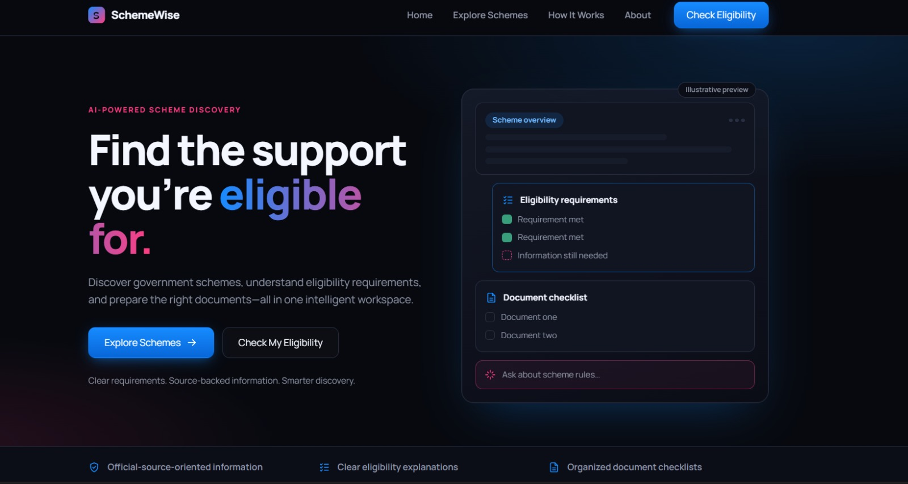
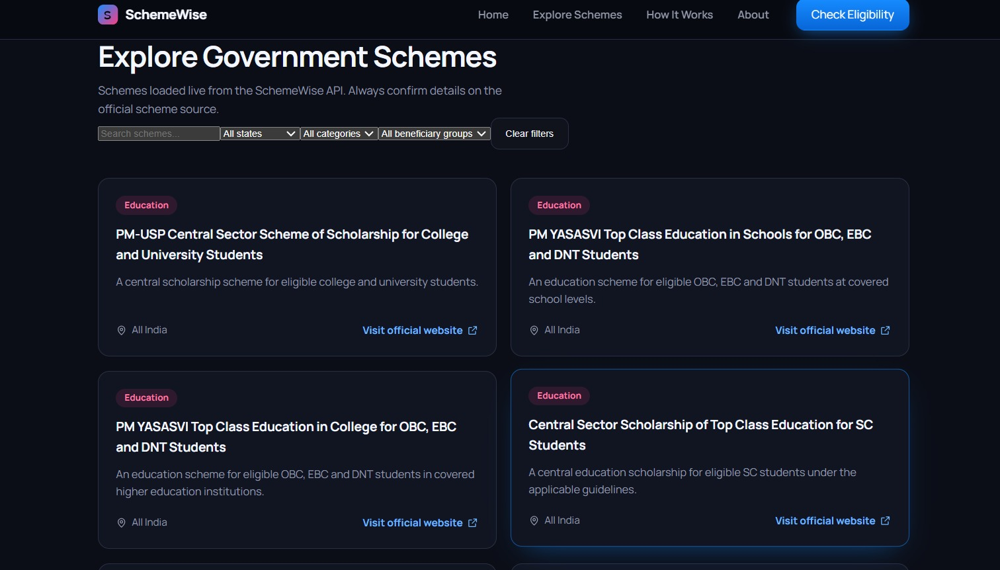
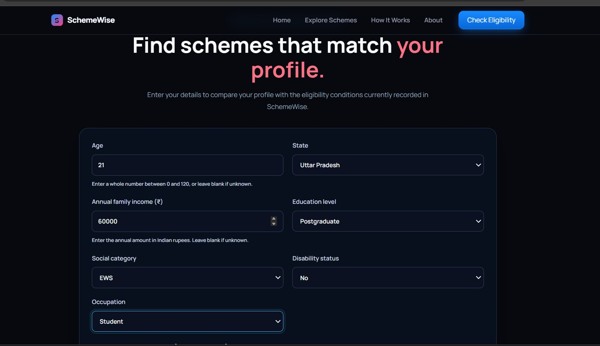
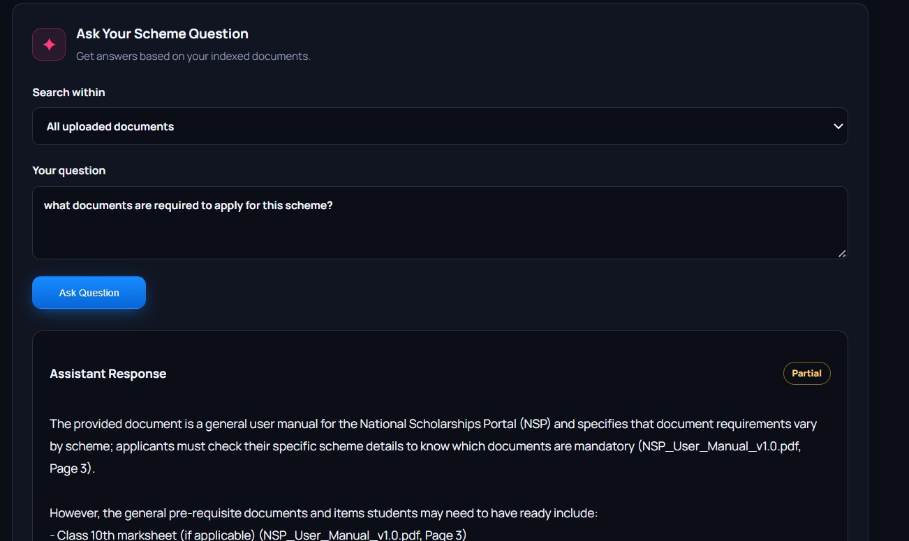
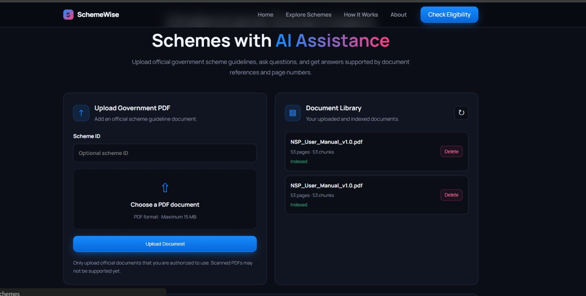
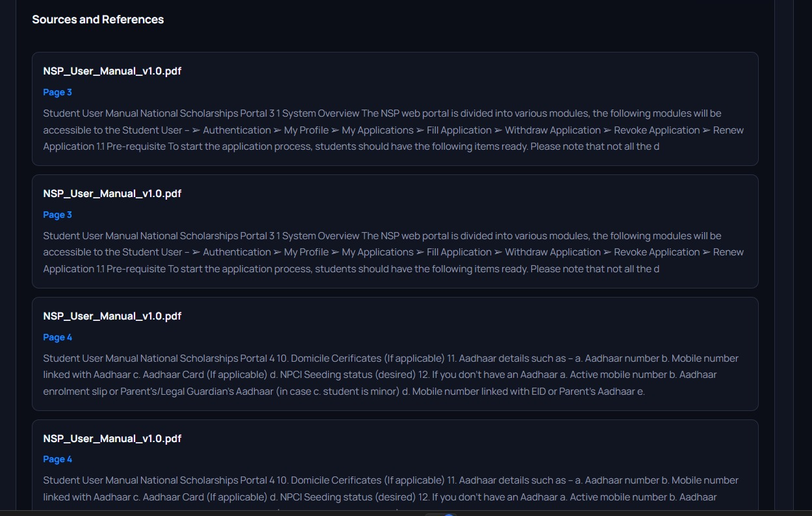

# SchemeWise — AI Government Scheme & Document Assistant

**Making government welfare schemes easier to discover, understand, and access.**

SchemeWise is an AI-powered government scheme and document assistant designed to help users explore government welfare schemes, understand eligibility requirements, and find relevant information in official documents.

The platform combines a React-based frontend, a FastAPI backend, a rule-based eligibility engine, PDF processing, vector search, and Retrieval-Augmented Generation (RAG) to provide more accessible information about government schemes.

Users can explore available schemes, check eligibility, upload government documents, and ask questions about the content of uploaded PDFs.

---

## 📸 UI Preview

> **Add your project screenshots below.** Create a `docs/images/` directory in the repository and place your screenshots inside it using the filenames shown below. The images will appear automatically in your GitHub README once you commit them.

### 1. Home Page

<!-- Replace this placeholder with your landing page screenshot. -->



*The SchemeWise landing page introduces the platform and its main features.*

### 2. Government Schemes

<!-- Replace this placeholder with your schemes section screenshot. -->



*Explore government schemes and review their key information.*

### 3. Eligibility Checker

<!-- Replace this placeholder with your eligibility checker screenshot. -->



*Enter relevant information to evaluate eligibility against the selected scheme's encoded rules.*

### 4. AI Document Assistant

<!-- Replace this placeholder with your document assistant screenshot. -->



*Upload government PDFs and ask questions about their contents.*

### 5. Document Upload and Processing

<!-- Replace this placeholder with your document upload screenshot. -->



*Upload documents for extraction, chunking, indexing, and retrieval.*

### 6. AI-Generated Answers and Sources

<!-- Replace this placeholder with your chatbot response screenshot. -->



*Review answers generated from retrieved document content and inspect the available sources.*

---

## ✨ Features

### 🏛️ Government Scheme Discovery
- Browse available government schemes.
- Review scheme descriptions and relevant information.
- Explore schemes to identify potentially suitable benefits.

### ✅ Eligibility Checking
- Submit personal and scheme-relevant information through an eligibility form.
- Evaluate eligibility using structured scheme rules.
- Represent results as eligible, not eligible, or insufficient information, where supported by the implementation.
- Support nested rule structures such as `all_of`, `any_of`, and `if_then`.
- Evaluate scheme-specific conditions through the eligibility engine.

### 📄 Government Document Processing
- Upload PDF documents containing government scheme information.
- Extract text from PDFs using PyMuPDF.
- Split extracted content into smaller chunks.
- Generate embeddings for semantic retrieval.
- Index document chunks in ChromaDB.
- Maintain document registry information.
- Retrieve document details and delete uploaded documents.

### 🤖 AI-Powered Document Assistant
- Ask natural-language questions about uploaded documents.
- Retrieve relevant document passages using vector search.
- Generate responses using a Retrieval-Augmented Generation workflow.
- Return source information associated with retrieved content, where available.

### 🧩 Modular Architecture
- React components for the user interface.
- FastAPI routers for API endpoints.
- Separate backend services for document processing, chunking, embeddings, vector storage, and RAG.
- Automated tests for API behavior and important backend services.

---

## 🛠️ Tech Stack

| Layer | Technologies |
|---|---|
| Frontend | React, JavaScript, Vite, CSS |
| Backend | Python, FastAPI |
| API Server | Uvicorn |
| Data Validation | Pydantic |
| PDF Processing | PyMuPDF |
| Retrieval | Embeddings and vector similarity search |
| Vector Database | ChromaDB |
| AI Integration | LLM API used by the application |
| Testing | Pytest |
| Version Control | Git and GitHub |

**Note:** Confirm the exact embedding provider, LLM model, and environment-variable names in your current configuration before documenting them as fixed dependencies.

---

## 🏗️ System Architecture

SchemeWise uses a frontend-backend architecture in which the React application communicates with the FastAPI backend over HTTP.

```text
                  ┌───────────────────────────┐
                  │       User / Browser      │
                  └─────────────┬─────────────┘
                                │
                                ▼
                  ┌───────────────────────────┐
                  │    React + Vite Client    │
                  │                           │
                  │  Scheme Discovery         │
                  │  Eligibility Checker      │
                  │  Document Assistant       │
                  └─────────────┬─────────────┘
                                │
                         HTTP / REST API
                                │
                                ▼
                  ┌───────────────────────────┐
                  │       FastAPI Server      │
                  │                           │
                  │  Main Application         │
                  │  API Routers              │
                  │  Eligibility Engine       │
                  │  Backend Services         │
                  └─────────────┬─────────────┘
                                │
               ┌────────────────┼─────────────────┐
               │                │                 │
               ▼                ▼                 ▼
      ┌────────────────┐ ┌───────────────┐ ┌────────────────┐
      │ Eligibility    │ │ PDF Processing│ │ RAG Pipeline   │
      │ Rule Evaluation│ │ and Chunking  │ │ and Retrieval  │
      └────────────────┘ └───────────────┘ └───────┬────────┘
                                                   │
                                                   ▼
                                         ┌──────────────────┐
                                         │ ChromaDB Vector  │
                                         │ Store            │
                                         └──────────────────┘
```

### Main Workflows

**Eligibility workflow**

1. The user selects a government scheme.
2. The frontend collects the relevant information.
3. The client sends an API request to the backend.
4. The eligibility engine evaluates the applicable rules.
5. The API returns the eligibility result.

**Document question-answering workflow**

1. The user uploads a government PDF.
2. The backend extracts text from the PDF.
3. Extracted text is divided into smaller chunks.
4. The embedding service generates vector representations.
5. The vector store indexes the chunks and their metadata.
6. The user submits a question.
7. The retrieval service finds relevant document chunks.
8. The RAG service uses the retrieved context to generate an answer.
9. The API returns the response and available source information.

---

## 📂 Project Structure

The following tree reflects the supplied SchemeWise structure. Generated files, caches, local databases, and environment files are represented selectively rather than listing every runtime artifact.

```text
SchemeWise/
│
├── client/
│   ├── public/
│   │   ├── favicon.svg
│   │   └── icons.svg
│   │
│   ├── src/
│   │   ├── assets/
│   │   │   ├── hero.png
│   │   │   ├── react.svg
│   │   │   └── vite.svg
│   │   │
│   │   ├── components/
│   │   │   ├── DocumentAssistant.jsx
│   │   │   ├── EligibilityChecker.jsx
│   │   │   ├── Features.jsx
│   │   │   ├── FinalCta.jsx
│   │   │   ├── Footer.jsx
│   │   │   ├── Hero.jsx
│   │   │   ├── HowItWorks.jsx
│   │   │   ├── Icons.jsx
│   │   │   ├── Navbar.jsx
│   │   │   ├── SchemeCard.jsx
│   │   │   └── SchemesSection.jsx
│   │   │
│   │   ├── hooks/
│   │   │   ├── useReveal.js
│   │   │   └── useSchemes.js
│   │   │
│   │   ├── services/
│   │   │   └── api.js
│   │   │
│   │   ├── App.css
│   │   ├── App.jsx
│   │   ├── config.js
│   │   ├── index.css
│   │   └── main.jsx
│   │
│   ├── eslint.config.js
│   ├── index.html
│   ├── package.json
│   ├── package-lock.json
│   ├── README.md
│   └── vite.config.js
│
├── server/
│   ├── data/
│   │   ├── eligibility_verification.md
│   │   └── schemes.json
│   │
│   ├── routers/
│   │   ├── __init__.py
│   │   ├── chat.py
│   │   └── documents.py
│   │
│   ├── schemas/
│   │   ├── __init__.py
│   │   └── chat_schemas.py
│   │
│   ├── services/
│   │   ├── chunking_service.py
│   │   ├── document_registry_service.py
│   │   ├── document_service.py
│   │   ├── embedding_service.py
│   │   ├── pdf_service.py
│   │   ├── rag_service.py
│   │   └── vector_store_service.py
│   │
│   ├── storage/
│   │   ├── chroma_db/
│   │   ├── uploads/
│   │   └── documents.db
│   │
│   ├── eligibility.py
│   ├── main.py
│   ├── requirements.txt
│   │
│   ├── test_api.py
│   ├── test_chunking_service.py
│   ├── test_document_registry_service.py
│   ├── test_document_service.py
│   ├── test_eligibility.py
│   ├── test_embedding_service.py
│   ├── test_nmmss_rules.py
│   ├── test_pdf_service.py
│   ├── test_pmkisan_rules.py
│   ├── test_rag_service.py
│   ├── test_retrieval_manual.py
│   ├── test_scheme007_rules.py
│   ├── test_vector_store_service.py
│   └── validate_scheme_data.py
│
├── docs/
│   └── images/
│       ├── homepage.png
│       ├── schemes.png
│       ├── eligibility-checker.png
│       ├── document-assistant.png
│       ├── document-upload.png
│       └── ai-answer-sources.png
│
├── .gitignore
└── README.md
```

### Folder Responsibilities

| Path | Responsibility |
|---|---|
| `client/src/components/` | Reusable UI components for the landing page, schemes, eligibility checker, and document assistant |
| `client/src/hooks/` | Custom React hooks for UI behavior and scheme data |
| `client/src/services/api.js` | Frontend API communication |
| `client/src/config.js` | Frontend configuration |
| `server/main.py` | FastAPI application entry point |
| `server/routers/` | API routes for chat and document operations |
| `server/schemas/` | Request and response data models |
| `server/eligibility.py` | Eligibility rule evaluation |
| `server/services/pdf_service.py` | PDF text extraction |
| `server/services/chunking_service.py` | Document chunk creation |
| `server/services/embedding_service.py` | Embedding generation |
| `server/services/vector_store_service.py` | Vector-store operations |
| `server/services/rag_service.py` | Retrieval and answer-generation workflow |
| `server/services/document_service.py` | Document-processing operations |
| `server/services/document_registry_service.py` | Document registry operations |
| `server/data/schemes.json` | Scheme data used by the application |
| `server/storage/` | Runtime uploads, vector-store data, and local document database |
| `server/test_*.py` | Automated tests for backend functionality |
| `docs/images/` | Screenshots displayed in this README |

---

## ⚙️ Installation and Setup

Follow these steps to run SchemeWise locally.

### Prerequisites

Install the following:

- Python 3.10 or a compatible version supported by your dependencies.
- Node.js and npm.
- Git.
- An API key for the configured LLM provider, if required by your backend.

### 1. Clone the Repository

```bash
git clone https://github.com/tiwarianshi/SchemeWise.git
cd SchemeWise
```

### 2. Set Up the Backend

Open a terminal in the project root.

```bash
cd server
```

Create a virtual environment:

```bash
python -m venv .venv
```

Activate it.

**Windows PowerShell:**

```powershell
.\.venv\Scripts\Activate.ps1
```

**Windows Command Prompt:**

```cmd
.venv\Scripts\activate.bat
```

**Linux/macOS:**

```bash
source .venv/bin/activate
```

Install backend dependencies:

```bash
pip install -r requirements.txt
```

Configure the environment variables required by your application. Check `main.py` and the relevant service files to identify the exact variable names.

If your application uses a Gemini API key through an environment variable named `GEMINI_API_KEY`, for example, configure that variable locally before starting the server.

> Do not commit API keys, passwords, or other secrets to GitHub.

### 3. Start the Backend

From the `server/` directory, run:

```bash
uvicorn main:app --reload
```

This command assumes `main.py` exposes the FastAPI instance as `app`.

The API should be available at:

```text
http://127.0.0.1:8000
```

Open the interactive API documentation at:

```text
http://127.0.0.1:8000/docs
```

### 4. Set Up the Frontend

Open a second terminal and return to the project root.

```bash
cd client
npm install
```

Configure the frontend API base URL using the variable and configuration format expected by `client/src/config.js`.

For example, if the application reads `VITE_API_BASE_URL` from the environment, a local environment file could contain:

```env
VITE_API_BASE_URL=http://127.0.0.1:8000
```

Use the variable name expected by your actual code; the example above is not a guarantee that the current implementation reads this exact name.

### 5. Start the Frontend

From the `client/` directory:

```bash
npm run dev
```

Open the local URL printed by Vite in your terminal. The default is commonly:

```text
http://localhost:5173
```

Make sure the backend is running and the frontend API configuration points to it.

---

## 🔌 API Endpoints

The following endpoints are exposed by the current application structure and API documentation.

| Method | Endpoint | Purpose |
|---|---|---|
| `GET` | `/` | Home or root endpoint |
| `GET` | `/health` | Health check |
| `GET` | `/api/schemes` | Retrieve available schemes |
| `POST` | `/api/eligibility/check` | Evaluate scheme eligibility |
| `POST` | `/api/documents/upload` | Upload and process a document |
| `GET` | `/api/documents` | List registered documents |
| `GET` | `/api/documents/{document_id}` | Retrieve a document's details |
| `DELETE` | `/api/documents/{document_id}` | Delete a registered document |
| `POST` | `/api/chat/ask` | Ask a question about indexed documents |

For exact request bodies, response schemas, and validation requirements, use the interactive Swagger documentation at `/docs` while the backend is running.

---

## 🧠 Eligibility Engine

The eligibility engine evaluates a user's submitted information against the rules configured for a scheme.

Its responsibilities include:

1. Receiving the eligibility profile.
2. Loading or identifying the relevant scheme rules.
3. Evaluating supported rule operators and nested conditions.
4. Distinguishing a failed eligibility condition from missing information.
5. Returning a structured eligibility result.

### Supported Rule Patterns

The implementation supports nested rule structures such as:

- `all_of`: all specified conditions must pass.
- `any_of`: at least one specified condition must pass.
- `if_then`: conditional evaluation based on the configured rule structure.

### Eligibility Results

| Result | Meaning |
|---|---|
| `eligible` | The evaluated conditions are satisfied. |
| `not_eligible` | At least one applicable mandatory condition fails. |
| `insufficient_information` | Required information is missing or cannot be evaluated adequately. |

The result depends on the completeness and correctness of the scheme's encoded rules.

**Important:** An eligibility result is only as reliable as the rules and scheme data used to generate it. Users should verify important decisions against the latest official scheme guidelines.

---

## 🔎 Retrieval-Augmented Generation (RAG)

SchemeWise uses a document retrieval pipeline to answer questions about uploaded government PDFs.

### Document Indexing

```text
PDF Upload
    ↓
PDF Text Extraction
    ↓
Text Chunking
    ↓
Embedding Generation
    ↓
ChromaDB Indexing
    ↓
Document Available for Retrieval
```

### Question Answering

```text
User Question
    ↓
Question Embedding / Retrieval
    ↓
Relevant Document Chunks
    ↓
Context-Aware LLM Response
    ↓
Answer + Available Source Information
```

### Backend Services

| Service | Responsibility |
|---|---|
| `pdf_service.py` | Extract text from PDFs |
| `chunking_service.py` | Divide text into retrieval-friendly chunks |
| `embedding_service.py` | Generate embeddings |
| `vector_store_service.py` | Store and retrieve vectors |
| `rag_service.py` | Coordinate retrieval and answer generation |
| `document_service.py` | Handle document-processing operations |
| `document_registry_service.py` | Manage document registry information |

The purpose of RAG is to ground generated responses in relevant document content rather than relying only on the language model's general knowledge.

Retrieval quality and answer accuracy still depend on document quality, chunking, embedding behavior, retrieval relevance, and the model's use of the retrieved context.

---

## 🧪 Testing

SchemeWise includes tests for important backend modules.

From the `server/` directory, install the dependencies and run:

```bash
pytest
```

To run a particular test file:

```bash
pytest test_api.py
```

Other available test files include:

- `test_eligibility.py`
- `test_chunking_service.py`
- `test_document_registry_service.py`
- `test_document_service.py`
- `test_embedding_service.py`
- `test_pdf_service.py`
- `test_rag_service.py`
- `test_vector_store_service.py`
- `test_nmmss_rules.py`
- `test_pmkisan_rules.py`
- `test_scheme007_rules.py`

The repository also includes `validate_scheme_data.py` for scheme-data validation.

Test results should be checked against the current code before claiming that all tests pass.

---

## 🔐 Security and Data Handling

When running or deploying SchemeWise, consider the following:

- Store API keys and secrets in environment variables.
- Keep `.env` files and virtual environments out of version control.
- Validate uploaded files and enforce appropriate file-size limits.
- Avoid exposing internal server paths or sensitive error details in API responses.
- Apply suitable access controls if document ownership or private user uploads are introduced.
- Configure CORS to allow only the frontend origins that need access.
- Review retention and deletion behavior for uploaded PDFs, extracted text, document metadata, and vector-store entries.
- Avoid uploading sensitive personal information unless the application has suitable safeguards.

Uploaded documents and vector indexes may be stored locally during development. Production deployments must account for persistent storage, backup, access control, and data retention.

---

## 🚀 Deployment

SchemeWise can be deployed by hosting the frontend and backend separately.

### Frontend

The React/Vite client can be deployed to a static hosting platform that supports Vite builds.

Build the frontend:

```bash
cd client
npm run build
```

The production build is normally generated in:

```text
client/dist/
```

Configure the frontend to use the deployed backend API URL.

### Backend

Deploy the FastAPI application to a Python-compatible hosting platform.

A typical start command is:

```bash
uvicorn main:app --host 0.0.0.0 --port $PORT
```

This command assumes the hosting environment provides the `PORT` variable and that `main.py` exports an `app` instance.

### Production Checklist

Before deployment:

- Configure the production API base URL.
- Add the deployed frontend origin to the backend CORS configuration.
- Configure all required API keys and environment variables.
- Ensure uploaded files and ChromaDB data use suitable persistent storage.
- Verify that database and vector-store paths are configured correctly.
- Run the automated test suite.
- Test PDF upload, document retrieval, question answering, and eligibility evaluation against the deployed services.

---

## ⚠️ Limitations

- Eligibility results depend on the completeness and accuracy of the encoded rules.
- Government scheme requirements may change over time, so scheme data must be verified and maintained.
- PDF extraction quality depends on the document format; scanned PDFs may require OCR.
- RAG answers may be incomplete if the relevant information is not retrieved.
- Source references do not automatically guarantee that an answer is correct.
- Local development storage requires additional planning for production deployments.

SchemeWise should be treated as an assistance tool, not as a replacement for official government notifications or final eligibility decisions made by the relevant authority.

---

## 🔮 Future Enhancements

Potential improvements include:

- Adding more verified government schemes.
- Automating scheme-data updates from official sources.
- Improving retrieval relevance with metadata filtering and reranking.
- Strengthening source-grounded answer generation and citations.
- Adding more detailed eligibility explanations.
- Generating personalized document checklists.
- Supporting OCR for scanned documents.
- Improving retrieval and answer-quality evaluation.
- Adding user accounts and saved scheme preferences.
- Introducing agentic workflows for multi-step scheme research and document assistance.

---

## 📚 Data Sources

Scheme information should be collected and verified against official government portals, notifications, operational guidelines, and scheme-specific documentation.

Uploaded documents can be used as retrieval sources for questions, but the freshness and authority of the underlying information should always be considered.

---

## 🤝 Contributing

Contributions that improve eligibility-rule accuracy, document processing, retrieval quality, testing, accessibility, and usability are welcome.

Before submitting changes:

1. Create a branch for your changes.
2. Keep changes focused and testable.
3. Run the relevant backend tests.
4. Verify frontend behavior when applicable.
5. Document configuration changes and new dependencies.

---

## 📄 License


This project is licensed under the [MIT License](LICENSE).

See the `LICENSE` file for details.

---

**SchemeWise — helping people understand government schemes through AI-powered eligibility checking and document assistance.**